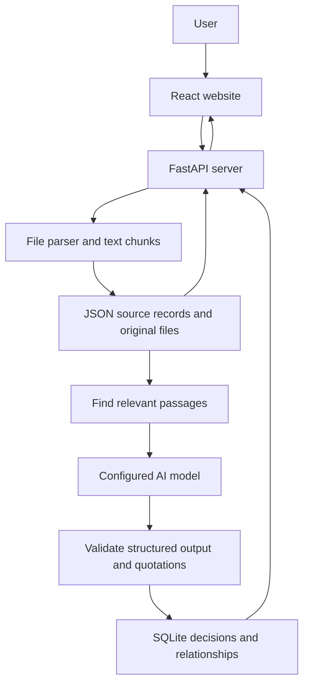

# How RAGret Works

RAGret turns uploaded conversations and reference documents into a searchable history of project decisions. Each decision links back to the text that supports it.

## 1. Main parts

| Part | Technology | Purpose |
| --- | --- | --- |
| Website | React and Vite | Upload files, ask questions, and explore decisions |
| Context graph | React Flow | Display connected decisions, people, and evidence |
| UI animation | Motion | Add interface transitions with reduced-motion support |
| API server | Python and FastAPI | Process files, validate results, and serve data |
| PDF processing | PyMuPDF | Extract text and display original PDF pages |
| Storage | SQLite, JSON, and local files | Save decisions, text passages, and original uploads |
| AI integration | Configurable model API | Extract decisions and generate evidence-based answers |

The browser talks to the API server. The server reads local storage and calls the model when extraction or answer generation is needed. API keys stay on the server.

## 2. Two kinds of uploads

- **Conversations** explain what the team discussed and decided. They can contain proposals, approvals, rejections, or changes of mind.
- **Reference documents** provide background, such as policies, requirements, or technical guidelines.

For example, a conversation can record that Raymund Zyron approved a sign-in requirement. A reference can explain the security guidance behind it. The reference itself does not prove that the team approved anything.

Messaging content currently comes from uploaded exports or pasted text. The app does not connect directly to messaging accounts.

## 3. Processing a file

1. The server saves the original file and extracts its text.
2. It divides the text into smaller passages called **chunks**, keeping source and PDF page information.
3. A reference document is indexed for retrieval without asking the model to invent decisions.
4. For a conversation, the server finds relevant reference passages and sends them with the conversation text to the model.
5. The model returns structured data: decisions, states, people, constraints, actions, and supporting quotations.
6. The server checks the output and verifies quotations against the supplied passages before saving it.

Unchanged conversation extractions can be reused without another model call. The **Re-extract** control processes a conversation again with the current references.

## 4. Building the context graph

The graph contains **nodes** and **relationships**. A node is an item, such as a decision, person, or document. A relationship explains how two items connect.

For example:

```text
Conversation → documents → Sign-in decision
Reference → provides guidance for → Sign-in decision
Person → participates in → Sign-in decision
Launch gate → depends on → Sign-in decision
```

The frontend gives different types their own colors and icons. Filters hide or show types, and hovering highlights connected context. Dependency impact follows documented dependency links; sharing a person or topic alone does not create a dependency.

The graph is stored in SQLite. React Flow displays it in the browser; a separate graph database is not required.

## 5. Answering a question

RAGret uses **Retrieval-Augmented Generation (RAG)**: it finds relevant saved information before asking the model to write an answer.

```text
Question → Find relevant decisions → Collect connected evidence
         → Send context to model → Show answer with citations
```

Retrieval uses word matching, graph connections, and recency. It does not require an embedding service or vector database.

Users can inspect the saved evidence behind a result. Conversation previews show the cited message and nearby messages when available. Reference previews show the quotation and PDF page. Opening the full source jumps to the cited message or page, and retained originals can be downloaded.

## 6. Storage and reliability

| Location | Contents |
| --- | --- |
| `backend/data/documents.json` | Source metadata and text chunks |
| `backend/data/context.sqlite3` | Decision records and graph relationships |
| `backend/data/originals/` | Retained original files |
| `backend/.env` | Private model configuration |

These local files are ignored by Git. Pushing the repository does not upload the active workspace or API key.

If the model cannot be reached, stored graphs and source viewers remain available. Questions can show clearly labeled saved evidence instead of a generated answer. New conversation extraction requires a working model connection.

Quote validation confirms where text came from; users still need to review its interpretation. The app is currently a local, single-user system. The prepared Northstar demo uses curated fictional conversation traces with a real public reference document; new conversation uploads use live extraction.

## 7. System architecture



The frontend displays information and sends requests. The backend handles file processing, retrieval, AI calls, validation, and storage. The AI suggests structured decision records; the backend checks them before adding them to the graph.

For questions, the backend reads saved decisions and source passages, retrieves relevant evidence, and asks the model to produce a cited answer. Opening a stored graph or document viewer does not require a new AI response.

## 8. When a new reference document is added

1. The user uploads a PDF or text document through **Reference documents**.
2. The server saves the original and creates searchable text chunks with source identifiers and page information.
3. The reference is indexed without creating team approval events or calling the model.
4. Future conversation extractions can retrieve relevant passages from this reference.

**Existing conversations are not automatically re-extracted.** Adding a new policy does not silently rewrite earlier decisions or attach new policy citations to every old trace. Use **Re-extract** on a conversation to analyze it with the current reference collection.

Example: A team uploads a new security policy after its first meeting. That policy is available when processing the next meeting. To review the first meeting against it, re-extract the first conversation explicitly.

## 9. When a new conversation is added

1. The user uploads an export or pastes a discussion through **Conversations**.
2. The server saves the source and divides its text into manageable batches.
3. It supplies existing decision subjects and scopes to the model so related mentions can reuse an established identity.
4. For each batch, it retrieves up to eight relevant reference passages and requests structured decision data.
5. It validates the model output and supporting quotes. After all batches succeed, it saves the conversation's extraction record.
6. It rebuilds the graph from the saved records in a database transaction, then returns the updated workspace to the frontend.

A matching decision gains more observations and evidence. A different subject or scope creates a separate decision. For example, **Offline mode / v1** and **Offline mode / v2** remain separate. Matching uses model reuse of existing labels plus conservative name normalization; it cannot guarantee perfect deduplication.

Earlier observations remain in the timeline when a new conversation is added. The current state is derived from documented history. A later proposal does not automatically cancel an earlier approval. Competing governing statements remain unresolved unless the evidence establishes which one supersedes the other.

Example:

| Conversation | Saved observation | Result |
| --- | --- | --- |
| First meeting | John Lorenzo proposes a sign-in requirement | Decision is proposed |
| Second meeting | Raymund Zyron explicitly approves the same requirement and scope | Same decision gains an approval observation |
| Third meeting | Jhon Paul suggests changing it | A new proposal is added; approval is not silently erased |

## 10. Updates, retries, and deletion

| Situation | Current behavior |
| --- | --- |
| Unchanged source is processed again | Saved extraction is reused unless re-extraction is forced |
| User selects Re-extract | The conversation is analyzed again; a successful result replaces that source's previous extraction record |
| Extraction fails | The uploaded source remains available for retry; an existing successful record is preserved |
| Reference collection changes | Future extraction uses the current collection; earlier conversations require explicit re-extraction for new grounding |
| Source is deleted | Its unsupported observations and links are removed; evidence supported by remaining sources is retained |

The current app processes extraction requests through a server-side lock rather than a background job queue. Supported uploads are limited to eight files per workspace, 10 MB per file, and 200 pages per PDF. Conversation extraction accepts up to 60,000 extracted characters per source; larger conversations must be split. A larger production deployment would need background workers, durable job tracking, authentication, and storage designed for multiple users.

## 11. What makes the architecture different from basic RAG?

A basic document RAG pipeline retrieves passages and asks a model to answer from them. RAGret adds a persistent decision layer between the documents and the answer.

```text
Basic document RAG:
Documents -> Chunks -> Retrieve passages -> Generate answer

RAGret:
Documents + Conversations -> Chunks -> Validated decision extraction
    -> Saved observations + Typed graph + Source receipts
    -> Retrieve decisions and connected evidence -> Generate cited answer
```

| Aspect | Basic document RAG baseline | RAGret implementation |
| --- | --- | --- |
| Main saved knowledge | Document passages and a search index | Passages plus decision observations and relationships |
| Retrieval | Often embedding similarity | Word matching plus graph connections and recency |
| History | Model interprets dates from retrieved passages | Saved observations form a timeline and feed explicit state rules |
| Repeated mentions | Often remain separate passages | Matching subject and scope can share one decision identity |
| Dependencies | May be described in generated text | Saved explicit links support database traversal |
| Evidence checking | Varies by implementation | Extraction quotes are checked against identified source chunks |
| Reference vs. discussion | Often searched together | Policy guidance is kept distinct from team approval evidence |

This compares RAGret with a basic baseline, not every RAG product. Graph retrieval, structured extraction, and provenance are established techniques. RAGret's contribution is their combination around decision history and source inspection; it is not a new foundation model or a claim of a novel research algorithm.

## 12. Significant algorithms and where they live

### A. Structured extraction and validation

**Code:** [graph_schema.py](backend/app/graph_schema.py), [provider.py](backend/app/provider.py), and `extract()` in [graph.py](backend/app/graph.py).

Pydantic schemas define the expected decision fields. The model returns structured JSON rather than unrestricted prose. `validate_extraction()` checks that chunk IDs exist, quotations occur in their cited text after normalization, named people appear in their quoted evidence, and reference quotations come from the supplied reference chunks. Unsupported event dates are cleared.

This is a combination of model interpretation and deterministic checks. A valid quotation establishes provenance; it does not prove that the model interpreted the passage correctly. The project uses a configurable hosted model API and does not train or fine-tune its own model.

### B. Reference passage ranking

**Code:** `reference_context()` in [graph.py](backend/app/graph.py).

The server compares conversation words with reference chunks. Matching words that appear in fewer chunks receive more weight. Scores are divided by the square root of the chunk's unique-word count to reduce preference for longer chunks.

```text
weight(word) = log((number_of_chunks + 1) / (chunks_containing_word + 1)) + 1

chunk_score = sum(weight(word)^2 for matching words)
              / sqrt(max(1, unique_words_in_chunk))
```

It selects up to eight positively matching chunks, with at most two from the same source page. This is a lightweight, IDF-weighted lexical heuristic, not BM25 or embedding search. It is inexpensive but can miss paraphrases that share few words.

### C. Decision identity matching

**Code:** `resolve()` inside `build_graph()` in [graph_store.py](backend/app/graph_store.py).

The system first matches normalized **subject + scope**. It can also merge multiword subjects within the same normalized scope when their word-set Jaccard similarity is at least `0.82`:

```text
similarity = shared_subject_words / all_distinct_subject_words
```

The model is also given existing labels to encourage reuse. This helps repeated mentions join one decision while keeping releases separate. It is conservative text matching, not a learned entity-resolution model, and can still miss or incorrectly merge similar subjects.

### D. Timeline state resolution

**Code:** `status_of()` in [graph_store.py](backend/app/graph_store.py).

Saved observations are ordered by documented date and stable source order, with special handling for supersession. Proposals do not replace established governing states. Competing governing states without clear supersession produce an unresolved conflict. Unknown dates remain unknown instead of using upload time as the event date.

These are application rules over saved observations, rather than asking the model to guess the current state on every page load.

### E. Graph-aware question retrieval

**Code:** `search()` and `ask()` in [graph.py](backend/app/graph.py).

Search considers a node's label, properties, and neighboring labels. Its score is:

```text
score = 10 * matched_query_words / max(1, query_word_count)
        + 0.1 * log(1 + connected_edge_count)
        + date_bonus
```

The date bonus uses the latest documented date, encoded as `YYYYMMDD / 1,000,000,000`. Word overlap dominates; connected-edge count and recency provide small adjustments. Nodes with no query-word overlap are normally excluded.

For questions, the server keeps up to five initial matches scoring at least 55% of the best match. It expands context through documented dependency, supersession, reconsideration, and contradiction links, then collects original receipts. Generation context is bounded to up to eight conversation passages and four reference passages when reference evidence exists, or twelve passages otherwise.

This favors traceable decision context but is not a semantic reranker or an unrestricted graph reasoning engine.

### F. Dependency impact traversal

**Code:** `impact()` in [graph_store.py](backend/app/graph_store.py).

A recursive SQLite query follows `depends_on` edges to find decisions affected by a selected decision. It keeps the path, avoids revisiting a node already on that path, and stops at a depth of 20. The API returns dependency chains with supporting receipts.

Unlike generating a likely impact statement from text alone, this follows saved explicit relationships. Its completeness depends on which dependencies were actually documented and extracted.

### G. Rebuilding the saved graph

**Code:** `store_record()`, `build_graph()`, and `rebuild()` in [graph_store.py](backend/app/graph_store.py).

The source extraction records are retained, and the graph is rebuilt transactionally from them after updates. This allows re-extraction or deletion to retract unsupported relationships. It is simple for the current small workspace; it is not an incremental graph update engine designed for a large corpus.

For a technical presentation, describe the architecture as **a decision-focused RAG system with validated extraction, persistent observation history, and a provenance-linked property graph**. Claims that it outperforms other RAG systems would require comparative evaluation; the current tests verify behavior and grounding rules, not benchmark superiority.

For run commands, see [SETUP.md](SETUP.md). For more detail, see [docs/IMPLEMENTATION.md](docs/IMPLEMENTATION.md).
